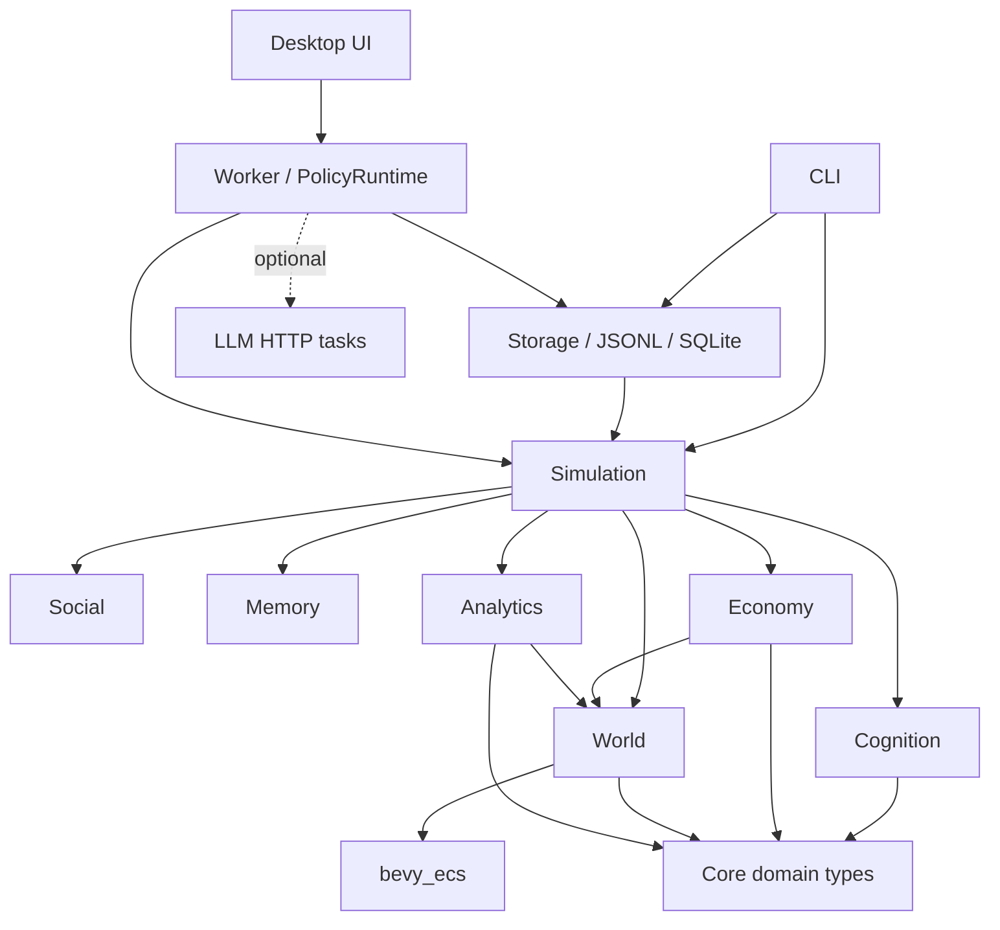

# 아키텍처

## 구현 범위와 의존성

현재 Workspace는 11개 Cargo 패키지로 구성합니다. 에이전트 구성은 `core`와 `world`에 포함하고, 파일·SQLite 영속화는 `storage`에 둡니다. GUI와 선택적 네트워크 런타임은 권한 있는 시뮬레이션 상태 변경 경계 밖에 둡니다.

| 패키지 | 책임 |
| --- | --- |
| `agentsociety-core` | 공통 타입, 설정, Agent/Action/Decision/Event, 정수 계좌와 원자적 정산 |
| `agentsociety-world` | bevy_ecs 엔티티, 안정적인 AgentId 색인, 초기화, 자원 풀, 위치, Tick |
| `agentsociety-economy` | 행동 검증, 시장·양자 제안, 다자 공동 계좌·계약, 공급 충격·재정 이체 |
| `agentsociety-social` | 거래·협력·제안 결과 기반 관계 갱신, 보관 한도, petgraph 분석 |
| `agentsociety-memory` | 이벤트 기반 구조화 기억과 제한된 관련 기억 검색 |
| `agentsociety-cognition` | 제한된 관찰·RuleBasedPolicy·성과별 목표 검토, 선택적 LlmPolicy/HybridPolicy·HTTP 어댑터 |
| `agentsociety-analytics` | 이벤트 기반 자원 수지, 자산 평가, Gini, 불변조건 감사 |
| `agentsociety-simulation` | 단일 권한의 Tick 진행, 복원·결정 재현, 정책 런타임과 체크포인트 모델 |
| `agentsociety-storage` | SHA-256 체크포인트, JSONL 검증, SQLite 트랜잭션·복구·조회 |
| `agentsociety-cli` | 실행·복원·분기·재현·조회·시나리오 실험, JSON/CSV 출력, 성능 측정 |
| `agentsociety-desktop` | eframe 화면·파일 선택, worker의 완료 상태·저장·복원·분기 |

코어 도메인 모델은 ECS derive에 의존하지 않습니다. `world`가 private `AgentComponent`로 모델을 감싸며, `BTreeMap<AgentId, Entity>`로 접근합니다. ECS의 내부 엔티티 번호나 쿼리 순서는 실행·기록 순서에 사용하지 않습니다. 월드 변경은 한 스레드에서 순차 실행합니다. 기본 Bevy 그래픽 엔진이나 Bevy 앱 런타임은 사용하지 않습니다.

`DecisionPolicy`는 불변 관찰만 받아 `Decision`을 반환합니다. 계좌를 변경할 권한이 없습니다. `Simulation::step_with_policy`로 동기 정책을 바꿀 수 있고 `step_with_overrides`로 에이전트별 외부 결정을 전달할 수 있습니다. `PolicyRuntime`은 선택적 HTTP 요청을 읽기용 관찰로 실행한 뒤 `step_with_decision_batch`에 결과를 전달합니다. 어느 경로도 검증·예약·정산을 우회하지 못합니다. 기본 빌드에는 HTTP 어댑터가 없지만 기록된 배치의 재적용 API는 사용할 수 있습니다.

데스크톱은 상태 변경을 worker 한 곳에 모읍니다. UI는 `Arc<View>`로 완료 상태를 읽고 채널로 Run/Pause/Step/Restart/Speed/Save/Load/Branch를 전달합니다. publication mutex를 잡은 채 Tick·HTTP·저장 복원을 실행하지 않습니다. 통계와 타임라인은 각각 600/1,500개로 제한하며, 외부 요청은 배치 타임아웃 안에 종료됩니다. 재시작·복원·분기는 새 상태가 완전히 검증된 뒤 교체하고 실패 시 이전 완료 상태를 유지합니다.

## 버전 선택

Rust 2024 edition, Cargo resolver 3, MSRV 1.95를 사용합니다. 직접 의존성의 실제 해결 버전은 `Cargo.lock`이 기준입니다.

| 라이브러리 | 선택 | 확인 근거 |
| --- | --- | --- |
| bevy_ecs | 0.19.1, default features 해제, `std`만 활성화 | [공식 API](https://docs.rs/bevy_ecs/0.19.1/bevy_ecs/world/struct.World.html), 배포 메타데이터의 Rust 1.95 요구사항 |
| rand / rand_chacha | 0.9.5 / 0.9.0 | 같은 rand_core 0.9 계열, [ChaCha 문서](https://docs.rs/rand_chacha/0.9.0/rand_chacha/) |
| serde / serde_json | 1.0.229 / 1.0.151 | 실제 도출된 JSON 및 round-trip 테스트 |
| clap | 4.6.5 | [공식 derive API](https://docs.rs/clap/4.6.5/clap/), 실제 CLI 통합 테스트 |
| thiserror / anyhow | 2.0.19 / 1.0.104 | 도메인 오류와 애플리케이션 오류 문맥 분리 |
| tracing / tracing-subscriber | 0.1.44 / 0.3.23 | stderr 로그, `RUST_LOG` 필터 |
| petgraph | 0.8.3 | 실제 관계의 무방향 투영과 연결 성분 분석 |
| eframe / egui_plot | 0.33.3 / 0.34.0 | 같은 egui 0.33 계열, 네이티브 Glow 화면 검증 |
| Tokio / Reqwest | 1.53.1 / 0.12.28 | 선택적 `llm` feature, Rustls HTTPS, 실제 loopback HTTP 테스트 |
| rusqlite / libsqlite3-sys | 0.41.1 / 0.39.1, bundled | [공식 API](https://docs.rs/rusqlite/0.41.1/rusqlite/), 실제 트랜잭션·프로세스 종료 후 복구 테스트 |
| sha2 | 0.10.9 | 체크포인트와 이벤트 체인의 SHA-256 손상 검출 |
| dhat | 0.3.3, CLI 개발 의존성 | [공식 문서](https://docs.rs/dhat/0.3.3/dhat/), 독립 예제 실행 파일의 할당 추적 |

[Cargo resolver 3 문서](https://doc.rust-lang.org/cargo/reference/resolver.html)에 따라 workspace 최상위에 resolver를 명시합니다. 라이브러리 호환성의 최종 검증은 기본 빌드와 `--all-features`의 실제 `cargo build`, `clippy`, `test` 결과로 수행합니다. SQLite는 번들 소스로 빌드하므로 별도 DB 서버가 필요하지 않습니다.

## 저장과 런타임 경계

각 Tick은 그 Tick의 이벤트와 통계만 반환합니다. CLI는 선택적으로 파일에 순차 기록하고 메모리에서 버립니다. 최근 행동·사회관계·기억은 에이전트별 설정된 개수로 제한합니다. 총 이벤트를 무조건 메모리에 쌓지 않습니다. 외부 자격증명은 HTTP 헤더에만 사용하며 상태·이벤트에 포함하지 않습니다.

최종 상태 JSON은 ECS 내부 구조를 포함하지 않으며 초기 설정, 규칙/포맷 버전, 월드, 가격, 계좌, 관계, 기억, 진행 중 양자 제안·담보, 목표 성과 구간, 마지막 외부 결정, 누적 수지, RNG 위치, 다음 이벤트 번호를 포함합니다. `Simulation::from_snapshot`이 버전과 도메인 불변조건을 검증하고 ECS와 난수를 복원합니다. `RunCheckpoint`는 여기에 공급자 설정·사용량·마지막 요청 Tick을 추가합니다. 공급자 설정 모델은 항상 읽을 수 있고, 실제 HTTP 런타임만 `llm` feature로 제한합니다.

JSONL은 초기 상태, 순서 있는 이벤트, Tick별 정책 상태와 완료 체크포인트를 기록합니다. SQLite는 동일 데이터를 Tick 단위로 원자적으로 확정하며 마지막 체크포인트 뒤의 확정 이벤트를 재현해 복구합니다. 모든 이력을 재실행하는 `replay`와 중단 지점을 되찾는 `recover`를 구분합니다. v0.5.0 포맷은 5이며 이전 버전 마이그레이션은 없습니다. 자세한 계약은 [persistence.md](persistence.md)에 있습니다.

`ProposalBook`은 에이전트별 최대 4개인 양자 제안을 보관하며 참여자 색인은 복원 시 재구성합니다. 변경 계획에서 두 계좌를 먼저 계산하여 준비·역제안·수락 실패가 일부 자산만 바꾸지 않게 합니다. 일반 중앙 주문과 같은 계좌의 사용 가능량을 공유하므로 중복 약속을 막습니다. 목표 검토는 실제 이벤트를 `GoalProgress`에 집계하고 별도의 순수 정책 함수로 변경 여부를 결정합니다. 이 모듈들은 GUI·HTTP·파일 저장소에 의존하지 않습니다.

## 이후 확장 방향 (미구현)

- 다자 조직·공동 재산·장기 계약은 `economy::InstitutionBook`의 별도 모듈입니다. 시나리오는 공개 설정과 저장 가능한 `ScenarioState`, 공급·손실·재정 처리 함수로 나눕니다. [조직](organizations.md), [시나리오](scenarios.md), [GUI 저장·복원](desktop.md)을 참고합니다.

